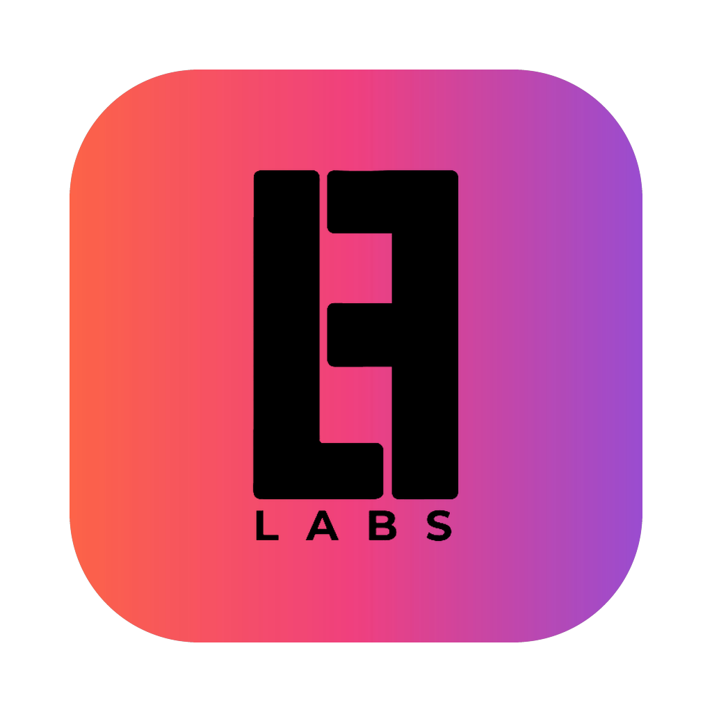

<div align="center">



# LF Studios

**Screenshots, screen recordings and video editing for your Mac.**<br/>
A native macOS menu-bar app. No account, no cloud: your captures stay on your Mac.

[Download](https://github.com/brightlifecreations-projects/LF-Studios-Releases/releases/latest) · [What’s new](CHANGELOG.md) · [Report an issue](https://github.com/brightlifecreations-projects/LF-Studios/issues/new)

<sub>Based on [Shotnix](https://github.com/OMARVII/Shotnix) (MIT License).</sub>

</div>

## What it does


**Screenshots**

- Capture an area, a window, the full screen, every display at once, or a long scrolling page stitched into one image.
- Annotate with arrows, shapes, text, callouts, numbered steps, a spotlight, highlighters, and blur or pixelate.
- Put shots on a gradient or image backdrop, crop them, and export PNG, JPEG or WebP.
- Copy text out of anything with on-device OCR (tables and links included), scan QR codes and barcodes, and pin shots on screen.
- Find any capture again in History, including by the text inside it.

**Screen recording and video editing**

- Record an area, a window or a display at 60 fps, with system audio, your microphone and your camera. Pause, resume, and recover takes after a crash.
- Recordings open already edited: zooms on your clicks and a smooth cursor.
- Show your camera in any shape and size, chosen before you record, or split screen with the screen, side by side or one above the other.
- Add captions from your narration (made on your Mac), music, title cards, transitions, logos and image overlays.
- Export MP4 up to 4K at 60 fps, or GIF.
- Save a whole edit as one `.lfs` file (LF Studios Project), and share your looks as a `.lfss` file (LF Studios Style). Projects from earlier versions (`.lfsp` from 1.9–1.11, `.lfstudios` from 1.8 and earlier), presets (`.lfstudiospresets`), and ShotStyle's still open.


LF Studios is available in English, Deutsch, Français, 简体中文, Русский, Українська and 日本語.

## Install

### Download the app

Get **LF-Studios.zip** from the [Releases page](https://github.com/brightlifecreations-projects/LF-Studios-Releases/releases/latest). It runs on Apple Silicon and Intel Macs with macOS 13 or later.

**Install 1.4.1 by hand once.** From 1.4.1 on, LF Studios updates itself: it
checks once a day (Settings → General → **Check for updates automatically**),
or whenever you choose LF Studios → **Check for Updates…**, and shows what's
new with **Install Update**, **Remind Me Later** and **Skip This Version**.
Nothing installs until you click Install Update. Your projects, recordings,
settings and permissions stay. Versions before 1.4.1 can't update
themselves, so install 1.4.1 or later with these steps once:

1. Unzip `LF-Studios.zip`.
2. Drag **LF Studios** to your Applications folder.
3. LF Studios isn't notarized by Apple yet, so run this once in Terminal:

   ```bash
   xattr -dr com.apple.quarantine "/Applications/LF Studios.app"
   ```

4. Open LF Studios.
5. Allow **Screen Recording** when macOS asks (and **Accessibility** if it asks for that too).
6. Quit LF Studios and open it again once, so the permissions take effect.

### Build from source

Requirements: macOS 13 or later, and either full **Xcode** (recommended, from the App Store) or the Xcode Command Line Tools with the **macOS 26 SDK**. Running the tests (`swift test`) needs full Xcode.

```bash
git clone https://github.com/brightlifecreations-projects/LF-Studios.git
cd LF Studios
bash scripts/setup-signing.sh   # once per Mac
bash build-app.sh               # add --universal for Apple Silicon + Intel
```

`build-app.sh` builds a release binary, assembles and signs the app bundle, and copies `LF Studios.app` to `/Applications`. Open it and allow Screen Recording and Accessibility when macOS asks, then quit and reopen it once.

- **Command Line Tools only:** if the newest SDK needs Xcode's macro plugins, the build retries with an installed macOS 26 SDK by itself. If none works, it tells you to install Xcode from the App Store.
- **Options:**
  - `--universal` builds one app for both Apple Silicon and Intel Macs.
  - `--no-install` leaves the app in `.build/app.noindex` instead of copying it to `/Applications`.

**Why the setup script:** macOS remembers those permissions for an app's signature. `scripts/setup-signing.sh` creates a self-signed "ShotStyle Local Signing" certificate in your login keychain (it stays on your Mac), and `build-app.sh` signs every build with it, so your permissions survive rebuilds. Without it, builds are signed ad-hoc: each rebuild looks like a new app, LF Studios asks for the permissions again, and recording stays blocked until you grant them. The build prints a warning when that happens.

**LF Studios keeps asking for permissions?** Clear the entries left over from earlier builds, then open LF Studios and allow them again:

```bash
tccutil reset ScreenCapture com.lfstudios.app
tccutil reset Accessibility com.lfstudios.app
```

## Contributing without Xcode

You don't need a Mac with Xcode to change LF Studios:

1. Open the repository in [claude.ai/code](https://claude.ai/code), or in Claude Code on any computer, and make the change there. Don't build or run it: cloud sessions and Macs without Xcode can't build LF Studios.
2. Push your work to a new branch.
3. Open a pull request into `main` and describe what changed.

The owner builds and tests the pull request on a Mac, merges it, and publishes a release with `scripts/publish-release.sh`.

## Default shortcuts

| Shortcut | Action |
|---|---|
| `Cmd + Shift + 4` | Area capture |
| `Cmd + Shift + 5` | Window capture |
| `Cmd + Shift + 3` / `Cmd + Shift + 6` | Fullscreen capture |
| `Cmd + Shift + 7` | Previous area capture |
| `Ctrl + Cmd + Esc` | Stop recording (from any app) |

Everything else (scrolling capture, OCR, timed capture, recording) can be assigned in **Settings → Shortcuts**.

## Privacy

LF Studios has no account, no analytics and no cloud. macOS asks before LF Studios can use:

- **Screen Recording:** to take screenshots and recordings.
- **Microphone and Camera:** only when you turn them on for a recording.
- **Speech Recognition:** to make captions, on your Mac.
- **Accessibility** (optional): to show the keys you press in a recording.

## Project layout

LF Studios is a Swift Package Manager project with no `.xcodeproj`. The executable is a thin wrapper around the testable `LFStudiosCore` library.

```
Sources/
├── LF Studios/         Executable entry point
└── LFStudiosCore/
    ├── App/           App lifecycle, menu bar, settings, updates
    ├── Capture/       Screenshot and recording engine (ScreenCaptureKit)
    ├── Annotation/    Screenshot editor
    ├── History/       Capture history
    ├── Hotkeys/       Customizable global shortcuts
    ├── OCR/           Text recognition (Vision)
    ├── Overlay/       Quick-access thumbnail, pins, toasts
    ├── Video/         Video editor and export
    └── Utilities/     Image export, permissions, helpers
Localization/          String Catalog and translations (scripts/localize.py)
```

Dependencies: [KeyboardShortcuts](https://github.com/sindresorhus/KeyboardShortcuts) for global shortcuts and [Sparkle](https://sparkle-project.org/) for update checks.

## Credits and license

LF Studios is based on [Shotnix](https://github.com/OMARVII/Shotnix) by the Shotnix Contributors, used under the MIT License. LF Studios is released under the same [MIT License](LICENSE). Third-party asset notices are in [THIRD_PARTY_NOTICES.md](THIRD_PARTY_NOTICES.md).
